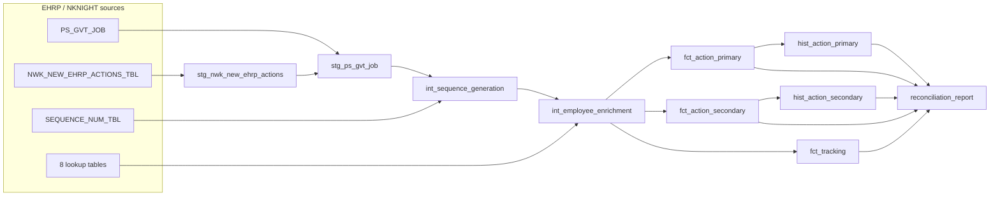

# dbt_ehrp2biis — EHRP2BIIS_UPDATE on Snowflake

This project converts the Informatica PowerCenter 9.6.1 workflow `wf_EHRP2BIIS_UPDATE`
(`XML/EHRP2BIIS_UPDATE`, mapping `m_EHRP2BIIS_UPDATE`) and the SQL the workflow runs afterwards
(`ehrp2biis_afterload.sql`) into a dbt project for Snowflake. The workflow reads EHRP (PeopleSoft) personnel
actions and loads them into BIIS.



## Informatica object → dbt object

| Informatica / Oracle | dbt |
|---|---|
| `SQ_PS_GVT_JOB` (SQL override, joins `PS_GVT_JOB` to `NKNIGHT.NWK_NEW_EHRP_ACTIONS_TBL`) | `staging/stg_ps_gvt_job` (same 97 columns, same 4-key inner join), `staging/stg_nwk_new_ehrp_actions` |
| `exp_GET_EFFDT_YEAR` → `lkp_OLD_SEQUENCE_NUMBER` → `exp_MAIN2BIIS.v_EVENT_ID` | `intermediate/int_sequence_generation` + `macros/generate_event_id.sql` |
| 9 connected lookups: `PS_GVT_EMPLOYMENT`, `PS_GVT_PERS_NID`, `PS_GVT_PERS_DATA`, `PS_GVT_AWD_DATA`, `PS_GVT_CITIZENSHIP`, `PS_HE_FILL_POS`, `PS_JPM_JP_ITEMS`, `PS_GVT_EE_DATA_TRK`, plus the sequence lookup | `intermediate/int_employee_enrichment` (LEFT JOINs, one row per lookup key) |
| `exp_MAIN2BIIS` and `exp_PERS_DATA` → `NWK_ACTION_PRIMARY_TBL` (260 cols) | `marts/fct_action_primary` |
| → `NWK_ACTION_SECONDARY_TBL` (209 cols) | `marts/fct_action_secondary` |
| → `EHRP_RECS_TRACKING_TBL` (10 cols) | `marts/fct_tracking` |
| afterload: `insert into action_primary_all / action_secondary_all ... where load_date = trunc(sysdate)` | `marts/hist_action_primary`, `marts/hist_action_secondary` (incremental, `delete+insert` on `event_id`) |
| afterload step 04: `retnd1_step_cd = NULL` where it is `'0.0000000000000'` and `event_id < 9000000000` | built into `fct_action_secondary.retnd1_step_cd` |
| afterload "update cancelled actions": delete and re-insert today's re-delivered events in `*_ALL` | the `delete+insert` on `event_id` in the hist models |
| afterload `update_sequence_number_tbl_p` + `truncate table nknight.nwk_new_ehrp_actions_tbl` | `on-run-end` → `finalize_batch` (opt-in): one transaction, only after a run that built every pipeline model |
| Session: commit interval 10,000, 3 targets loaded in parallel | Each mart is built in one Snowflake transaction (`create or replace table as select`), and the three marts build in parallel threads |

### Generated marts

`scripts/generate_marts.py` builds the three mart models and `stg_ps_gvt_job` from the XML:

- It follows every `CONNECTOR` from each target column back to the Source Qualifier, Lookup or Expression port
  that feeds it.
- It writes one line per target column, in target order, cast to the target datatype. The comment on each line
  shows where the column comes from and the original Informatica expression.
- Target columns with no connector become typed `NULL`s. That is what PowerCenter writes: 136 of 260 primary
  columns and 175 of 209 secondary columns are unconnected in the mapping.

Never edit the generated files by hand. Change the generator and run `python scripts/generate_marts.py`.

## Transformation rules (exp_MAIN2BIIS)

All rules come from the port expressions in the XML. For example:

| Port | Informatica | Snowflake (dbt) |
|---|---|---|
| `o_AGCY_ASSIGN_CD` | `COMPANY \|\| GVT_SUB_AGENCY` | `{{ infa_concat(['company','gvt_sub_agency']) }}` |
| `o_HE_AL_BALANCE` (+19 other leave/hours ports) | `IIF(HE_AL_BALANCE=0, NULL, HE_AL_BALANCE)` | `{{ zero_to_null('he_al_balance') }}` → `case when he_al_balance = 0 then null else he_al_balance end` |
| `o_BASE_HOURS` | `IIF(GVT_WORK_SCHED='I', STD_HOURS, STD_HOURS*2)` | `case when gvt_work_sched = 'I' then std_hours else std_hours * 2 end` |
| `o_CASH_AWARD_AMT` | `DECODE(TRUE, IN(GVT_NOA_CODE,'840',…) AND NOT IN(ERNCD,'RCR','RLC'), GOAL_AMT, IN(GVT_NOA_CODE,'817','889'), GOAL_AMT, NULL)` | `case when … then goal_amt when … then goal_amt else null end` |
| `o_PROBATION_DT` | `ADD_TO_DATE(PROBATION_DT, 'MM', -12)` | `{{ dbt.dateadd('month', -12, 'probation_dt') }}` |
| `o_LOAD_ID` / `o_LOAD_DATE` | `'NK' \|\| YYYYMMDD of SYSDATE` / `trunc(sysdate)` | `{{ load_id() }}` / `{{ load_date() }}`; the `load_date` var pins the date for replays |

Places where Informatica/Oracle and Snowflake behave differently, and how the macros (`macros/informatica_functions.sql`) handle them:

- **NULL concatenation.** Informatica/Oracle `||` skips NULL operands, but Snowflake's `||` returns NULL.
  `infa_concat` coalesces each operand to `''` and turns an empty result back into NULL (Oracle stores `''` as NULL).
- **`IS_SPACES`.** It is true only for all-space strings; a NULL input falls through to the `IIF` else branch.
- **Date → string ports.** `AS_OF_DAY varchar(10)` gets the date in PowerCenter's default `MM/DD/YYYY` format.
- **String length.** Strings longer than the target column are truncated to its length, as PowerCenter does at
  the target port (e.g. `EMPLID` varchar 11 → `EMP_ID` varchar 8).
- **String → number targets** (`SPECIAL_PROGRAM_CD`, `EFFSEQ`) use `try_cast`.

### Event IDs

Informatica sorts the Source Qualifier rows by `EFFDT`. For each row it sets
`v_EVENT_ID = IIF(year = previous year, v_EVENT_ID + 1, EHRP_SEQ_NUMBER + 1)`, where `EHRP_SEQ_NUMBER` is the
year's row in `NKNIGHT.SEQUENCE_NUM_TBL`. Because the rows are sorted, each year's rows are consecutive, so
this equals:

```sql
ehrp_seq_number + row_number() over (partition by extract(year from effdt) order by effdt, emplid, empl_rcd, effseq)
```

That is the default `event_id_strategy: high_water_mark`.

- IDs match the legacy numbering, and rebuilding the same batch gives the same IDs.
- The intermediate model is a table, so all three marts share one set of IDs.
- If an `EFFDT` year has no row in `SEQUENCE_NUM_TBL`, the event ID is NULL, as in Informatica. The `not_null`
  tests then fail the build.

`event_id_strategy: snowflake_sequence` uses the `NEXTVAL` of a Snowflake `SEQUENCE`, which `on-run-start`
creates. Those IDs are unique, but numbering doesn't restart per year and changes on every rebuild, so it
does not reproduce BIIS event IDs. It is opt-in only.

### Lookups

Every lookup in the XML uses `Lookup policy on multiple match = Use Any Value`. `dedupe_lookup` keeps exactly
one row per lookup key, picked in a deterministic order, so a LEFT JOIN can never duplicate an action.
`PS_JPM_JP_ITEMS` keeps the override's filter (`jpm_cat_type = 'DEG' and eff_status = 'A'`) and joins on
`JPM_PROFILE_ID = EMPLID`.

## Not converted (source not in this repository)

`ehrp2biis_afterload.sql` calls stored procedures whose bodies are not in this repository:

- `HISTDBA.UPDT_ERP2BIIS_CRE8_REMARKS01_P`
- `HISTDBA.UPDATE_ERP2BIIS_NO900S01_p`
- `HISTDBA.ERP2BIIS_CRE8_REMARKS_900s01`
- `HISTDBA.UPDATE_ERP2BIIS_900SONLY01_P`
- `HISTDBA.UPDT_ORIG_CANCELLED_TRANS01_P`
- `chk_ehrp2biis_wip_status_p`
- `GATHER_EHRP2BIIS_RUNCOUNTS_P`

Because of that:

- **Remarks and 900-series events.** The remarks table (`NWK_ACTION_REMARKS_TBL` → `ACTION_REMARKS_ALL`) and the
  900-series event rows are built by those procedures, so they are not produced here.
- **WIP status changes.** `PROCESS_TABLE.P_STARTDT` and `BIIS_WIP_STATUS_CHANGED_DT` are maintained by
  `chk_ehrp2biis_wip_status_p`, so they are not reproduced either.
- **Sequence update.** The body of `update_sequence_number_tbl_p` isn't in the repo.
  `finalize_batch` assumes it stores the highest regular event ID (< 9,000,000,000) per
  `EFFDT` year. Confirm against the real procedure before turning on `apply_post_load_side_effects`.
- **`actstage_load`.** It runs `action_stage_load.sql`, which is not in the repository either.

Add the SQL for these procedures and they can be converted as more models or `on-run-end` operations.

## Places this project differs from the conversion request

- **Base hours.** The request's example rule is `case when std_hrs_frequency = 'H' then std_hours * 2`, but the
  mapping XML uses `IIF(GVT_WORK_SCHED='I', STD_HOURS, STD_HOURS*2)`. That rule matches the request's own
  description ("doubles standard hours for non-intermittent schedules"), so this project implements the XML rule.
- **Extra lookup.** The request names 7 lookups. The XML also connects `lkp_PS_GVT_EE_DATA_TRK`, which feeds
  `EVENT_SUBMITTED_DTE`, so it is included.
- **Extra history model.** `hist_action_secondary` mirrors `ACTION_SECONDARY_ALL` from the same afterload block
  as `hist_action_primary`.
- **Intermediate models are tables.** That way each event ID is assigned once and shared by all three marts.
  Staging models are views and marts are tables, as requested.

## Running

```bash
pip install dbt-core dbt-snowflake dbt-duckdb   # tested with dbt-core 1.12.5, dbt-snowflake 1.10.8, dbt-duckdb 1.10.1
cd dbt_ehrp2biis
```

**Local run, no credentials.** Uses a DuckDB file and synthetic fixtures (`scripts/generate_dev_fixtures.py`;
no real person data):

```bash
dbt seed  --profiles-dir .
dbt build --profiles-dir . --exclude resource_type:seed --vars '{load_date: "2026-02-27"}'
```

**Snowflake.** Set `SNOWFLAKE_ACCOUNT`, `SNOWFLAKE_USER`, `SNOWFLAKE_PASSWORD` (or `SNOWFLAKE_PRIVATE_KEY_PATH`),
`SNOWFLAKE_ROLE`, `SNOWFLAKE_WAREHOUSE`, `SNOWFLAKE_DATABASE` and `SNOWFLAKE_SCHEMA`. Sources default to schemas
`EHRP` and `NKNIGHT` in the same database; override them with the `ehrp_database`, `ehrp_schema`,
`nknight_database` and `nknight_schema` vars.

```bash
dbt build --profiles-dir . --target snowflake
# nightly production run, including the afterload side effects on NKNIGHT:
dbt build --profiles-dir . --target snowflake --vars '{apply_post_load_side_effects: true}'
# side-by-side counts against the tables the Informatica session loaded:
dbt build --profiles-dir . --target snowflake --vars '{legacy_target_schema: INFO_TARGET_DEV}'
```

The `on-run-end` side effects (`finalize_batch`) run only after a `dbt run` / `dbt build` that built every pipeline model with no failures (a partial `--select` never finalizes a batch). The sequence update and the trigger-table delete commit together.

## Validation

- **`models/schema.yml`:**
  - `unique` and `not_null` on every event ID (`fct_action_primary.event_id`, `fct_action_secondary.event_id`,
    `fct_tracking.biis_event_id`, intermediates, hist models).
  - `not_null` on EMPLID, plus `relationships` tests back to the trigger table and from the secondary and
    tracking tables to primary.
  - `no_zero_values` on all 20 zero-to-null target columns.
- **Singular tests (`tests/`):**
  - `assert_zero_to_null_conversion` checks each zero-to-null column against its source value. The column
    pairs come from the mapping (`macros/generated_zero_to_null_columns.sql`).
  - `assert_event_ids_continue_sequence`: each year's IDs are gap-free and start at the high-water mark + 1.
  - `assert_base_hours_rule` and `assert_agency_assignment_code` check those two rules.
  - `assert_reconciliation_passes` fails the build if any row of the reconciliation report is `FAIL`.
- **`models/validation/reconciliation_report.sql`:**
  - Compares the row count at every layer (sources, staging, intermediate, marts, history) with the Source
    Qualifier baseline (`PS_GVT_JOB` ⋈ trigger table).
  - Checks that `event_id` is distinct.
  - With `legacy_target_schema` set, also compares the dbt marts with the rows Informatica loaded into
    `NWK_ACTION_PRIMARY_TBL`, `NWK_ACTION_SECONDARY_TBL` and `EHRP_RECS_TRACKING_TBL` for the same `load_date`.
- **Same results on DuckDB and Snowflake.** `scripts/build_snowflake_parity_sql.py` turns the
  Snowflake-compiled models into a single read-only SELECT over the fixture rows, so it runs without CREATE
  privileges. `scripts/compare_parity.py` then diffs the Snowflake result cell by cell against the DuckDB marts.
